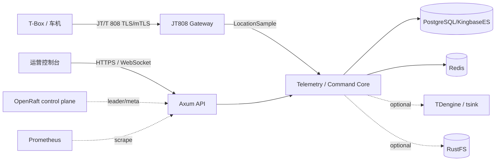

# 星途 TSP 架构文档

> 基线：2026-11-25，Rust 2021 / Axum 0.8 / Tokio / SQLx / PostgreSQL 16 / KingbaseES V8R6/V9 / Redis / OpenRaft。

## 1. 目标

```text
终端接入 -> 实时位置 -> 事务内业务 -> 告警/指令 -> 运营闭环
```

设计原则：

1. **单一计算入口**：HTTP、JT/T 808、模拟器都调用 `services::telemetry::ingest`。
2. **事务内一致**：车辆状态、轨迹、行程、围栏、告警同一 DB 事务提交。
3. **权威数据唯一**：业务真相在 PostgreSQL/KingbaseES；Redis/时序库/对象存储可降级。
4. **接入与业务解耦**：协议层只产出 `LocationSample`。
5. **默认可降级**：PostGIS/KGIS、TDengine、RustFS、Redis 均有 fallback 或明确失败。
6. **可水平拆分**：API、网关、调度器、数据库、对象存储分别扩容。

## 2. 系统上下文



边界：

- 终端不直接访问数据库。
- 浏览器只访问 API/静态资源/WebSocket。
- Redis 不保存业务真相。
- OpenRaft 只管理控制面，不复制业务表。
- TDengine 是可重建的查询副本。

## 3. 运行时组件

| 组件 | 职责 | 关键配置 |
| --- | --- | --- |
| API | REST、JWT、WebSocket、控制台 | `TSP_BIND` |
| JT808 Gateway | TCP/TLS、注册/鉴权/心跳/位置 | `TSP_JT808_ADDR` |
| Scheduler | 离线、保留、对账、导出恢复 | Redis leader |
| Demo Simulator | 演示车流 | `TSP_DEMO_MODE` |
| Media Hub | 1078 会话、录制、归档 | `TSP_MEDIA_UDP_ADDR` |
| Maintenance | spool、清理、sweeper、Vault 同步 | `services/maintenance.rs` |

同一二进制支持多种角色，由部署方式拆分。

## 4. 模块分层

```text
api/            HTTP 传输与鉴权
services/       领域服务 + 后台维护
db/             数据访问/迁移/空间/PII
models/         API 与领域模型
jt808/          808 编解码/网关/控制
standards/      809/32960/1078/19056
media/          媒体与 RustFS
cluster/ raft/  协调与控制面
security/       密钥、PII、合规
```

依赖方向：

```text
api -> services -> db
api -> media
jt808 -> services
standards -> 独立编解码
```

禁止：

- db 依赖 api
- 协议层直接写 SQL
- handler 内做长事务/无限循环

## 5. 数据模型

核心表：

```text
users / vehicles / vehicle_state / terminals
telemetry / trips / geofences / geofence_states
alerts / commands / audit_logs / pii_vault
schema_migrations
timeseries_reconciliations / reconciliation_export_jobs
export_download_tokens / export_alert_state
```

空间：

```sql
telemetry.geom geometry(Point,4326)
vehicle_state.geom geometry(Point,4326)
```

无 PostGIS/KGIS 时保留 `lat/lon`，查询降级 Haversine/bbox。

## 6. 关键流程

### 6.1 定位入库

```text
HTTP / JT808 / simulator
 -> LocationSample
 -> ingest (single transaction)
    -> telemetry
    -> vehicle_state
    -> trips
    -> geofence_states
    -> alerts
 -> dashboard cache clear
 -> WebSocket fan-out
 -> optional TDengine enqueue
```

### 6.2 轨迹查询

```text
API -> timeseries::load_trajectory
    -> tsink (optional)
    -> TDengine (if enabled)
    -> PostgreSQL fallback
```

### 6.3 归档

```text
JT1078 UDP -> media hub -> keyframe-aligned segment
 -> RustFS put (retry)
 -> failed: local spool -> replay
 -> playback: remux H.264/AAC -> fMP4
```

### 6.4 对账

```text
PG count/min/max vs TDengine
 -> mismatch -> history + webhook
 -> scheduled leader-only checks
 -> export jobs -> encrypted CSV + token
```

## 7. 数据库选型

| 场景 | 选择 |
| --- | --- |
| 本地/演示 | SQLite |
| 中小生产 | PostgreSQL + PostGIS |
| 信创 | KingbaseES + KGIS（`DB_MODE=pg`） |
| MySQL 兼容 | MySQL 8 |
| 大型轨迹 | 上述 + TDengine（`dual`/`tdengine`） |

KingbaseES 复用 PostgreSQL wire，但有独立 `database_engine=kingbase` 标识与兼容处理。

## 8. 部署架构

### 单机

```text
tsp 容器 -> SQLite/外部 DB
```

### 集群

```text
LB -> API x N
LB -> Gateway x N
        -> PostgreSQL/KingbaseES
        -> Redis
        -> RustFS
        -> TDengine (optional)
```

### K8s

`deploy/k8s/` 提供 namespace、configmap、secret、API、gateway、PostgreSQL、Redis、RustFS、TDengine、PVC 示例。

## 9. 非功能设计

- **可用性**：Redis leader、数据库连接池、降级
- **一致性**：单事务业务写；时序副本最终一致
- **可观测**：`/api/health`、`/api/ready`、`/api/metrics`
- **安全**：JWT RS256、Argon2、RBAC、PII 加密、TLS/mTLS
- **容量**：索引、分页、缓存、异步导出、对象存储
- **可维护**：后台任务独立模块，协议/传输分层

## 10. 已知限制

- 808 是 2019 子集，不是全量标准
- 809/32960/1078/19056 只实现部分消息/帧
- KGIS、TDengine、RustFS 未在真实生产规模验证
- 对账/导出有上限，非无限流
- 未实现跨地域多活
- 未通过第三方标准合规检测

## 11. 相关文档

- [架构图集](ARCHITECTURE_DIAGRAMS.md)
- [技术方案](TECHNICAL_SOLUTION.md)
- [快速开始](QUICKSTART.md)

- [TECHNICAL_GUIDE.md](TECHNICAL_GUIDE.md)
- [OPERATIONS_GUIDE.md](OPERATIONS_GUIDE.md)
- [SECURITY.md](SECURITY.md)
- [CLUSTER.md](CLUSTER.md)
- [KINGBASE_KGIS.md](KINGBASE_KGIS.md)
- [TIMESERIES_BACKENDS.md](TIMESERIES_BACKENDS.md)
