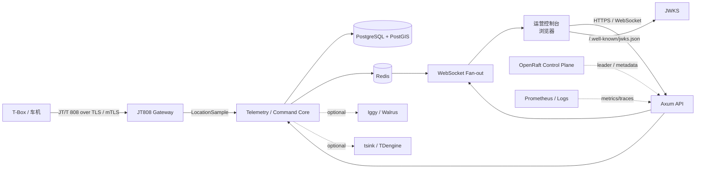
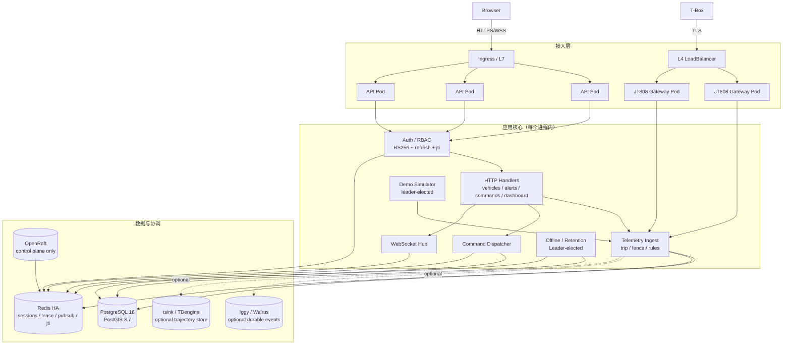
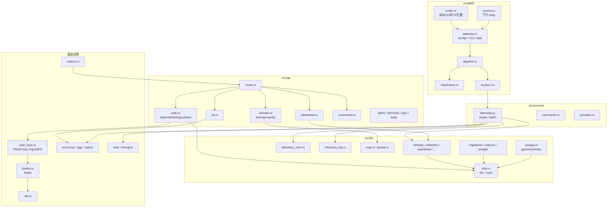
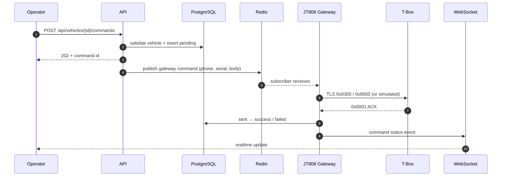
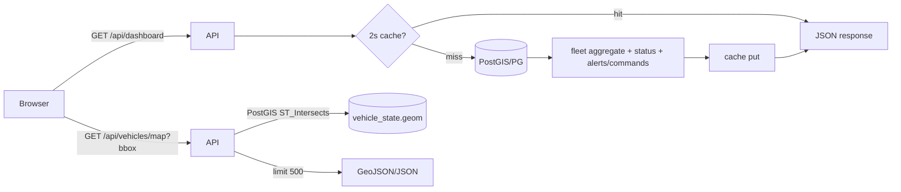
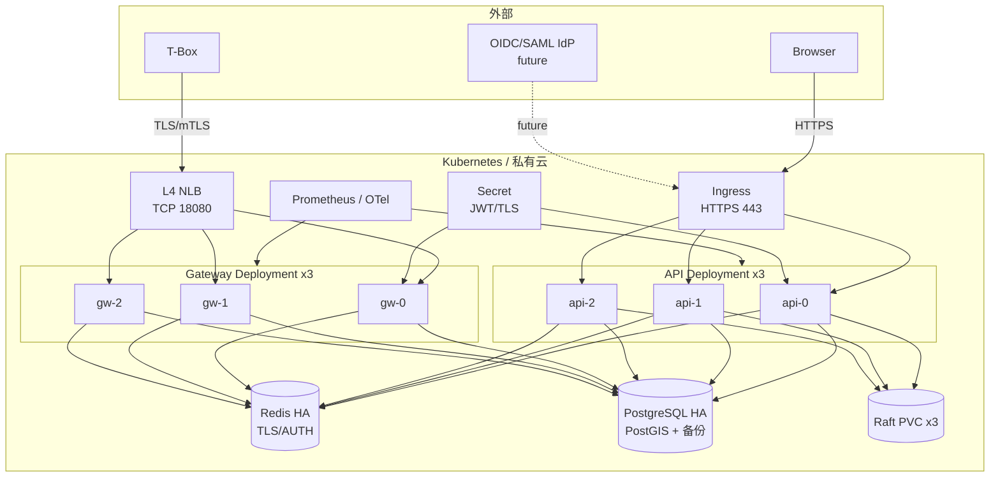

# 星途 TSP 技术架构

> 版本基线：Rust 2021 / Axum 0.8 / Tokio 1.54 / SQLx 0.8 / PostgreSQL 16 + PostGIS 3.7 / Redis 0.32 / OpenRaft 0.10。
> 本文描述**当前代码实际能力**；JT/T 808 是子集实现，JT/T 809、GB/T 32960 是帧/登录体骨架，不构成标准认证。

## 1. 架构目标

TSP 的主链路是：

```text
终端接入 → 实时位置 → 事务内业务计算 → 告警/指令 → 运营闭环
```

设计原则：

1. **单一计算入口**：HTTP、JT/T 808、模拟器最终都调用 `services::telemetry::ingest`，规则只实现一次。
2. **事务内一致性**：车辆状态、轨迹、行程、围栏状态、告警在同一数据库事务内提交。
3. **权威数据在 PostgreSQL**：Redis 只做短期协调/广播；TSDB/事件日志均为可选派生存储。
4. **接入与业务解耦**：`LocationSample` 是协议无关输入；新增 MQTT/809/32960 只增加适配器。
5. **安全默认**：RS256/JWKS、短 access token、refresh 轮换、Redis TLS/AUTH、JT808 TLS/mTLS。
6. **可水平拆分**：API、JT808 网关、调度器、Redis、PostGIS 可以分别扩容。

## 2. 系统上下文



**边界说明**

- `T-Box` 只通过网格网关访问，不直接访问数据库。
- 浏览器只访问 API/静态资源；WebSocket 订阅实时事件。
- PostgreSQL 是业务权威源；Redis/TSDB/Iggy 不是业务真相。
- OpenRaft 只管理控制面，不复制业务行。

## 3. 运行时容器



### 3.1 进程角色

同一二进制支持多种角色，由部署方式拆分：

| 角色 | 主要职责 | 关键配置 |
| --- | --- | --- |
| API | REST、JWT、WebSocket、看板 | `TSP_BIND` |
| JT808 Gateway | TCP/TLS 接入、分帧、注册/鉴权/位置 | `TSP_JT808_ADDR`、TLS/mTLS |
| Scheduler | 离线清扫、轨迹保留、模拟器 | Redis leader lease |
| 单机 Demo | API + 网关 + Seed + 模拟器 | `TSP_DEMO_MODE=true` |

## 4. 代码组件



### 4.1 分层规则

- `api`：HTTP 提取、鉴权、参数校验、DTO 映射；不直接拼 SQL。
- `jt808`：帧编解码、连接生命周期、注册/鉴权/位置分发；业务写库通过 `services`。
- `services`：事务编排、事件发布、指标；唯一遥测入口。
- `db`：连接池、方言适配、查询/事务；规则引擎在 `telemetry_rules`，行程在 `telemetry_trip`。
- `auth_keys`：RS256 key ring、JWKS、旧 key 保留窗口。
- `cluster`/`raft`：Redis 协调和控制面；不承载业务数据。
- `seed`：演示数据；`bootstrap`：启动装配。

## 5. 关键数据流

### 5.1 实时位置 / 0x0200 / 0x0704

```mermaid
sequenceDiagram
    autonumber
    participant T as T-Box
    participant G as JT808 Gateway
    participant S as Telemetry Service
    participant DB as PostgreSQL/PostGIS
    participant R as Redis
    participant W as WebSocket
    participant TS as Optional TSDB

    T->>G: TLS frame (0x0200 / 0x0704)
    G->>G: 7E unescape + XOR + parse
    G->>G: terminal auth / session / heartbeat
    alt 0x0704 batch
        G->>DB: one IN (...) duplicate precheck
        G->>S: Vec<LocationSample>
        S->>DB: BEGIN; all samples
    else single
        S->>DB: BEGIN; one sample
    end
    S->>DB: insert telemetry + update vehicle_state
    S->>DB: trip state / fence batch upsert / rules
    S->>DB: COMMIT
    S->>R: publish telemetry / alert
    S-->>W: broadcast
    S-->>TS: optional enqueue
    G-->>T: 0x8001 general response
```

要点：

- 0x0704 批量 **单事务**，重复点一次 `IN (...)` 预检查。
- 围栏先批量读 prior，再多值 upsert。
- 事务提交后才发事件，避免“告警已发但事务回滚”。
- PG 是权威；TSDB 失败不应回滚业务事务。

### 5.2 指令下发



演示模式使用 `TSP_COMMAND_MODE=simulated`；生产必须 `jt808` 并完成终端 ACK 校验。

### 5.3 登录 / JWKS / refresh / 吊销

```mermaid
sequenceDiagram
    autonumber
    participant U as User
    participant A as API
    participant DB as PostgreSQL
    participant K as JWT Key Ring
    participant R as Redis
    participant J as JWKS Consumer

    U->>A: POST /api/auth/login
    A->>DB: load user + Argon2 verify
    A->>K: RS256 sign access (15m) + kid
    A->>DB: store refresh SHA-256 (7d)
    A-->>U: access + refresh + user
    J->>A: GET /.well-known/jwks.json
    A-->>J: active + previous public keys
    U->>A: Authorization: Bearer access
    A->>K: verify by kid
    A->>R: GET revoked:jti (negative cache 5s)
    A-->>U: 200 / 401
    U->>A: POST /api/auth/refresh
    A->>DB: revoke old refresh; issue rotated
    U->>A: POST /api/auth/logout (access + refresh)
    A->>R: SETEX revoked:jti TTL
    A->>DB: revoke refresh
```

要点：

- Access token 无状态、短 TTL；本地 5 秒未吊销缓存，跨节点吊销窗口 ≤5 秒。
- Refresh token 只存 SHA-256，轮换/吊销。
- JWKS 支持 active + previous key；旧 key 保留窗口由配置决定。
- 认证失败/注销审计入库。

### 5.4 看板 / 地图



## 6. 数据归属与一致性

| 数据 | 权威存储 | 其他副本 | 一致性 |
| --- | --- | --- | --- |
| 车辆/终端/围栏/告警/指令/审计 | PostgreSQL | 无 | 事务 ACID |
| 轨迹/位置 | PostgreSQL + PostGIS | tsink/TDengine 可选 | PG 权威，TSDB 可重建 |
| 会话/节点/leader lease | Redis | 无 | TTL/租约，允许丢失 |
| jti 吊销 | Redis + 进程内 5s 缓存 | 无 | fail-closed |
| refresh token | PostgreSQL | 无 | 哈希存储、轮换 |
| Raft 元数据 | 本地 `raft-data` | 无 | 控制面，不承载业务 |
| 看板 | PG 查询 + 2s 内存缓存 | 无 | 最多 2s 陈旧 |
| 事件回放 | Iggy 可选 | Redis Pub/Sub 不持久 | 默认实时；回放需 durable bus |

## 7. 部署拓扑



### 7.1 网络边界

- 公网只暴露 L4 NLB（JT808 TLS）和 Ingress（HTTPS）。
- PostgreSQL/Redis 仅在集群内网；Redis 生产使用 `rediss://` + AUTH。
- JT808 可启用客户端证书 mTLS + CIDR 白名单。
- API 的 JWKS 端点公开，供网关/第三方验签。
- K8s Secret 挂载 JWT/TLS PEM，不写入镜像。

## 8. 失败模式

| 失败 | 影响 | 当前行为 | 建议 |
| --- | --- | --- | --- |
| PostgreSQL 不可用 | 业务读写失败 | API 5xx；网关入库失败 | HA/备份/只读降级 |
| Redis 不可用 | 会话/租约/事件/吊销检查失败 | jti 检查 fail-closed；事件扇出中断 | Redis HA + 监控 |
| OpenRaft 不可用 | 控制面选主/元数据 | 业务仍可用；租约退化为 Redis | 生产优先 K8s Lease/etcd |
| JT808 网关宕机 | 终端断连 | 终端重连到其他 Pod；Redis 会话 TTL | L4 健康检查/多副本 |
| TSDB 不可用 | 轨迹分析不可用 | PG 权威数据不受影响；enqueue 失败 | 可选组件降级 |
| 看板缓存过期 | 首次请求慢 | 2s TTL，之后命中 | 预聚合 |
| Access token 泄露 | 15 分钟窗口 | logout 吊销 jti；短 TTL | 设备绑定/风险控制 |

## 9. 容量与演进

当前实测（debug、单 API 节点、4 vCPU/12GB）：

| 规模 | 在线车辆 | dashboard 冷启动 | 列表 p50 | 地图 p50 |
| --- | ---: | ---: | ---: | ---: |
| 10K | 10,000 | 212 ms | 22.8 ms | 38.9 ms |
| 100K | 100,000 | 1.57 s | 39.7 ms | 39.5 ms |
| 1000K | 1,000,000 | 3.62 s | 281 ms | 60.4 ms |

详细数据：[BENCHMARK_REPORT.md](BENCHMARK_REPORT.md)。

演进优先级：

1. 生产数据访问从 `AnyPool` 收敛到 `PgPool` + 编译期 SQL。
2. 1M 列表 keyset/总数缓存、dashboard 预聚合、PG 分区。
3. 控制面从文件 Raft 收敛到 K8s Lease/etcd。
4. OIDC/SAML/MFA（当前未实现）。
5. 单一 durable event bus / TSDB 选型，避免多套可选组件并存。

## 10. 当前限制

- JT/T 808 是子集：不支持加密报文、全量 2019 命令/参数/视频；JT/T 809/GB/T 32960 是骨架。
- OIDC/SAML/MFA 未实现；当前本地账号 + RS256。
- `SQLx AnyPool` 无编译期 SQL 校验。
- OpenRaft 使用文件 JSON 日志/状态机，仅控制面。
- 1M 在线不是单机生产承诺。
- 标准合规需外部测试/认证，代码不构成合规声明。

关联文档：

- [SECURITY.md](SECURITY.md)
- [TECH_STACK.md](TECH_STACK.md)
- [STRUCTURE.md](STRUCTURE.md)
- [BENCHMARK_REPORT.md](BENCHMARK_REPORT.md)
- [POSTGIS.md](POSTGIS.md)
