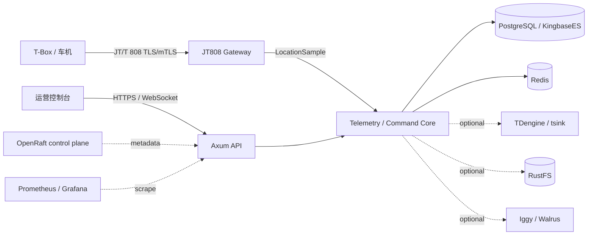
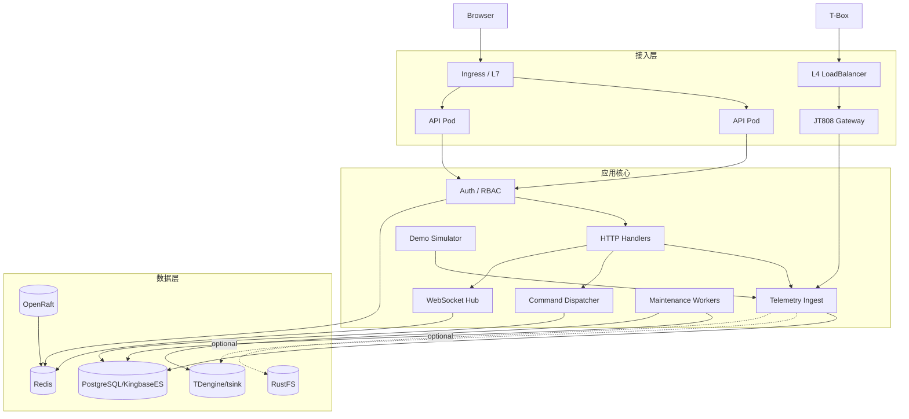
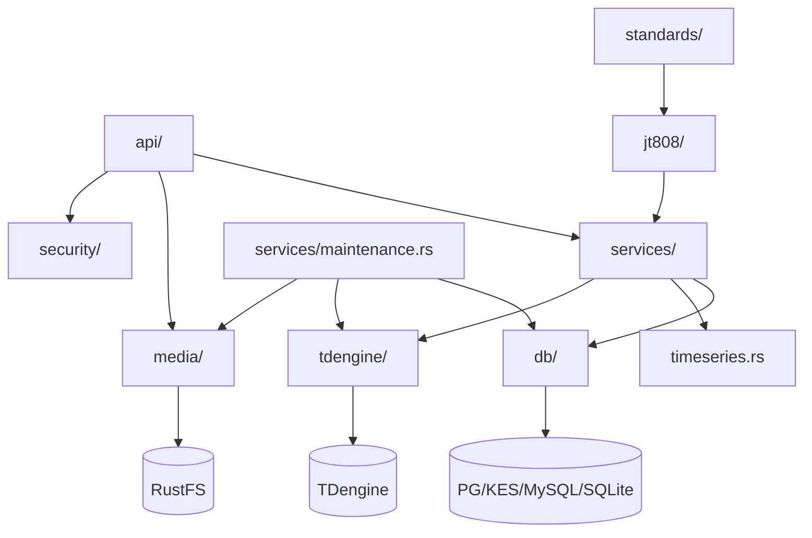
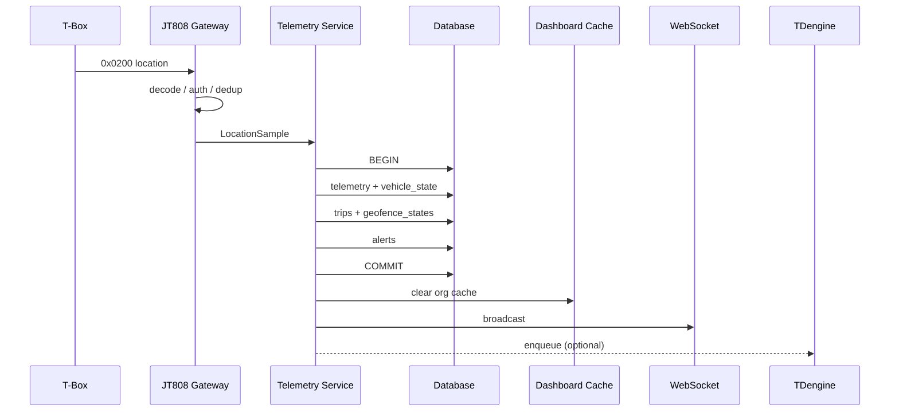
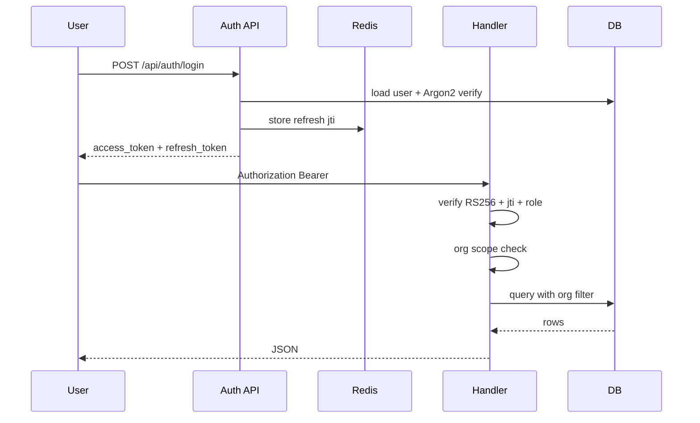
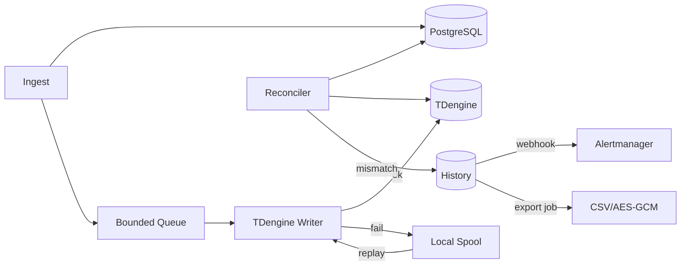
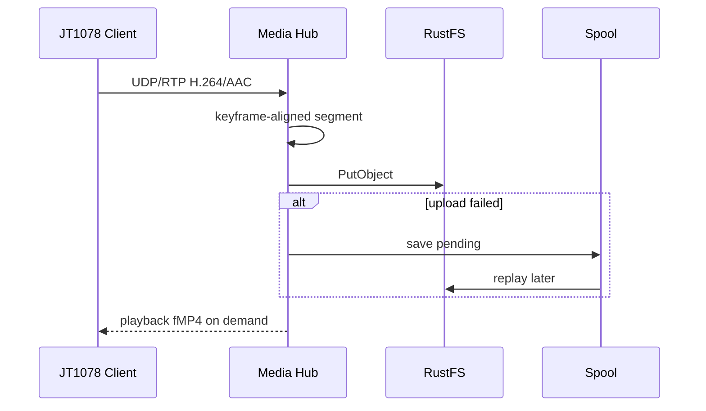
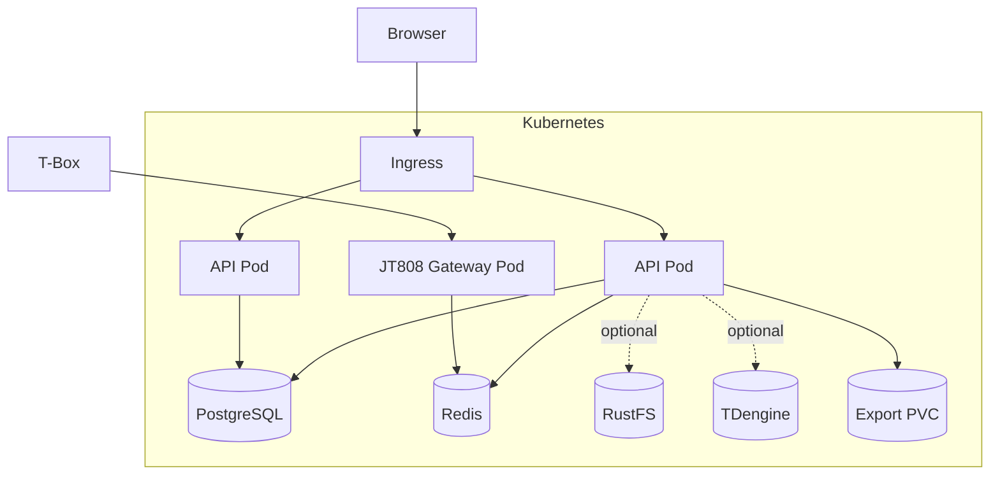
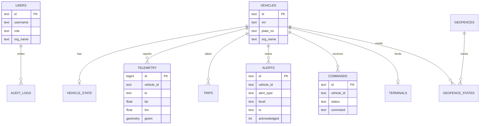

# 星途 TSP 架构图集

本文件用 Mermaid 描述当前代码的真实结构。图中“可选”表示有配置开关或可降级，不代表已通过生产验证。

## 1. 系统上下文

边界：

- 终端不直接访问数据库。
- 浏览器只访问 API、静态资源和 WebSocket。
- Redis 不保存业务真相。
- TDengine/tsink/RustFS/Iggy/Walrus 都是可选组件，可降级或明确失败。
- OpenRaft 只管理控制面。

## 2. 运行时容器

## 3. 代码模块依赖

规则：

- `db` 不依赖 `api`。
- 协议层不直接写 SQL。
- handler 不做无限循环或长事务。
- 外部组件失败不得阻塞核心业务事务。

## 4. 定位入库时序

关键点：

- 业务写入在同一事务。
- 缓存清理和 WebSocket 在提交后。
- TDengine 是异步副本，失败不影响主事务。

## 5. 认证与 RBAC

## 6. TDengine 双写与对账

## 7. RustFS 录制归档

## 8. Kubernetes 部署

## 9. 数据模型

## 10. 可选组件状态

| 组件 | 默认 | 失败行为 |
| --- | --- | --- |
| PostGIS/KGIS | 尝试启用 | 降级 lat/lon |
| TDengine | 关闭 | `tdengine` 模式启动失败；`dual` 降级 |
| tsink | 关闭 | 查询回退 PG |
| RustFS | 关闭 | 不归档，spool 不启用 |
| Redis | 单机可关闭 | 本地 leader / 本地广播 |
| Iggy/Walrus | 关闭 | 退回 Redis/本地 |

## 11. 相关文档

- [ARCHITECTURE.md](ARCHITECTURE.md)
- [TECHNICAL_SOLUTION.md](TECHNICAL_SOLUTION.md)
- [OPERATIONS_GUIDE.md](OPERATIONS_GUIDE.md)
- [USER_GUIDE.md](USER_GUIDE.md)
