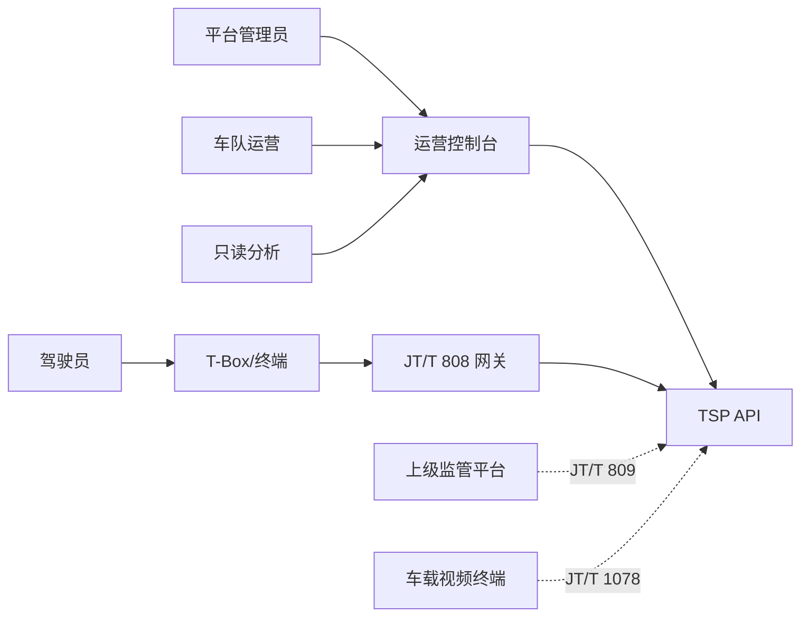
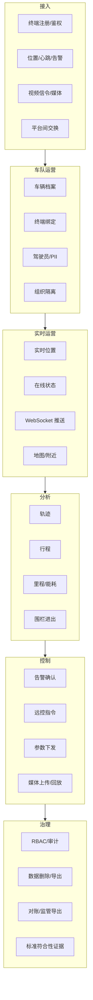
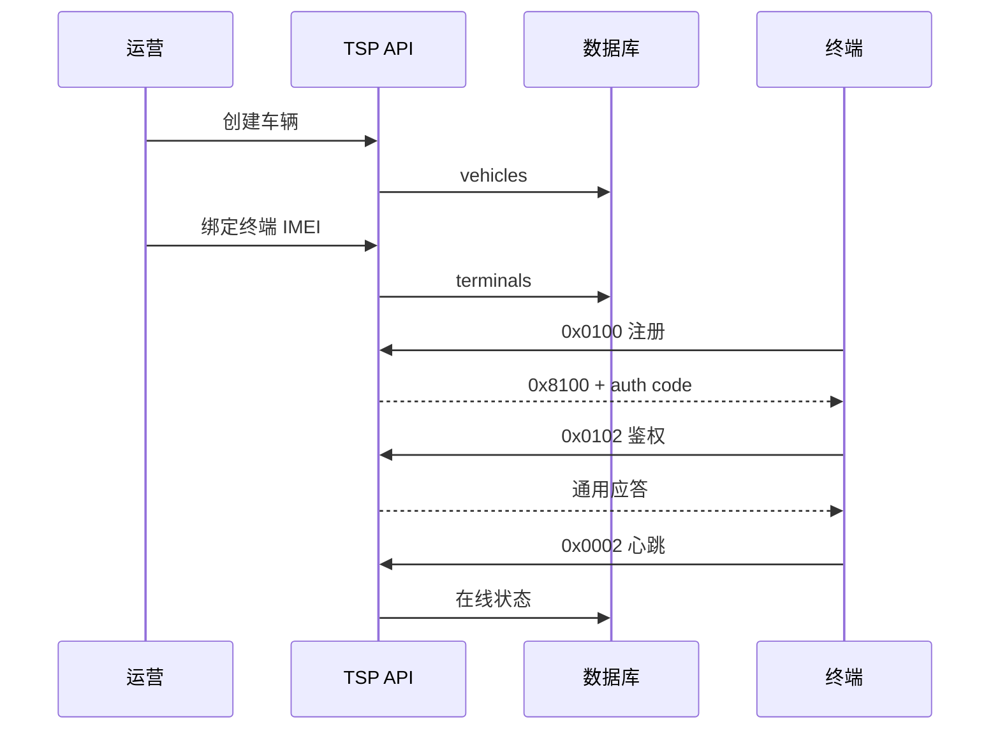
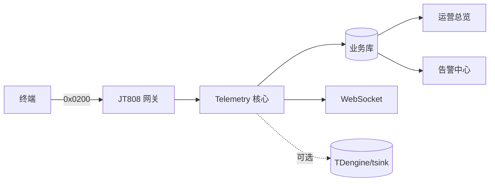
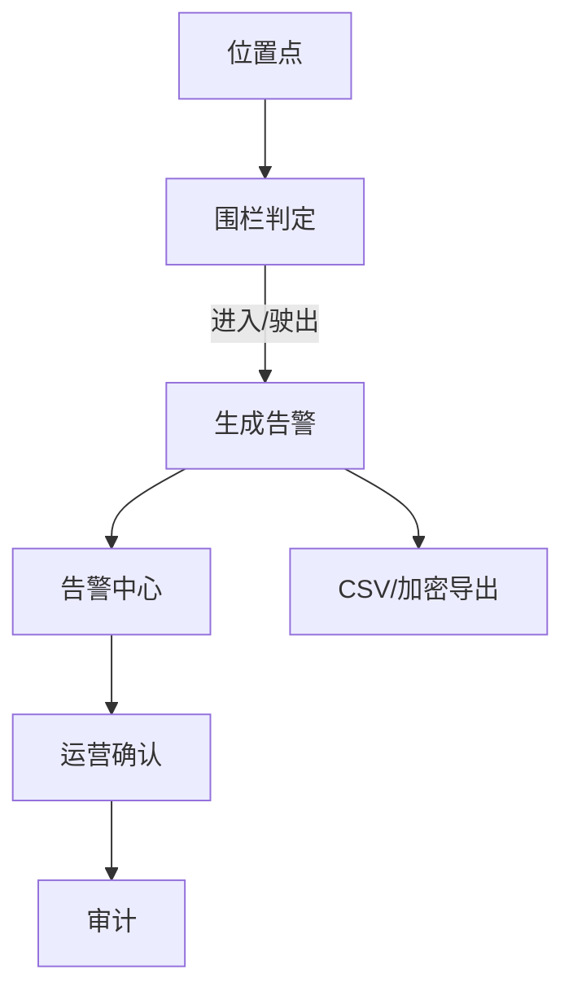
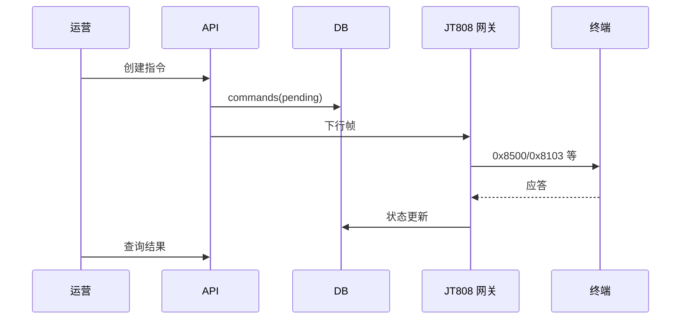
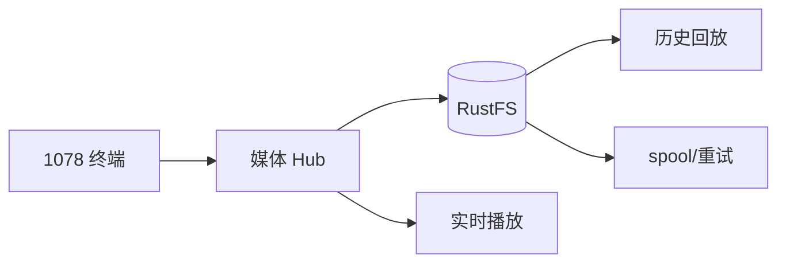
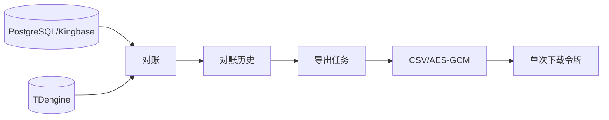
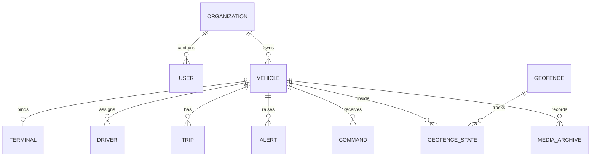

# 星途 TSP 业务架构

## 1. 定位

星途 TSP 面向道路运输/车队运营场景，提供：

```text
车辆资产
终端接入
实时位置
轨迹/行程
电子围栏
告警处置
远程车控
媒体归档
运营看板
标准/监管数据交换
```

当前是参考实现/POC 基线，不是已通过监管备案或第三方标准检测的成品。

## 2. 业务参与者



| 角色 | 主要诉求 |
| --- | --- |
| 平台管理员 | 组织、账号、终端、系统配置、审计 |
| 车队运营 | 车辆、围栏、告警、指令、行程 |
| 只读分析 | 看板、轨迹、报表 |
| 驾驶员/终端 | 注册、鉴权、位置/告警上报、接收指令 |
| 监管平台 | 平台数据交换、报警/监管请求 |
| 视频终端 | 实时/历史视频、资源上传 |

## 3. 业务能力地图



## 4. 核心业务流程

### 4.1 车辆与终端入网



### 4.2 实时位置与告警



### 4.3 围栏与告警处置



### 4.4 远控指令



### 4.5 视频与归档



### 4.6 对账与监管导出



## 5. 业务对象



当前模型用 `org_name` 做组织隔离，尚未实现独立组织表。

## 6. 权限模型

| 能力 | admin | operator | viewer |
| --- | --- | --- | --- |
| 组织范围 | 全部 | 本组织 | 本组织 |
| 车辆写 | 是 | 是 | 否 |
| 告警确认 | 是 | 是 | 否 |
| 远控指令 | 是 | 是 | 否 |
| 终端管理 | 是 | 是 | 否 |
| PII 删除 | 是 | 否 | 否 |
| 对账/导出 | 是 | 本组织 | 否 |
| 审计 | 是 | 否 | 否 |

## 7. 业务指标

```text
车辆在线率
终端在线率
今日里程
告警数/级别
指令成功率
围栏进出次数
轨迹完整率
对账差异数
PII 删除请求数
```

## 8. 业务边界

- 不替代真实终端/平台联调。
- 不替代监管备案。
- 不替代第三方标准检测。
- 不承诺所有地方/团体标准自动适用。
- 视频/远控的实际效果依赖终端和网络。

## 9. 相关文档

- [ARCHITECTURE_DIAGRAMS.md](ARCHITECTURE_DIAGRAMS.md)
- [TECHNICAL_SOLUTION.md](TECHNICAL_SOLUTION.md)
- [OPERATIONS_ARCHITECTURE.md](OPERATIONS_ARCHITECTURE.md)
- [DEPLOYMENT_ARCHITECTURE.md](DEPLOYMENT_ARCHITECTURE.md)
