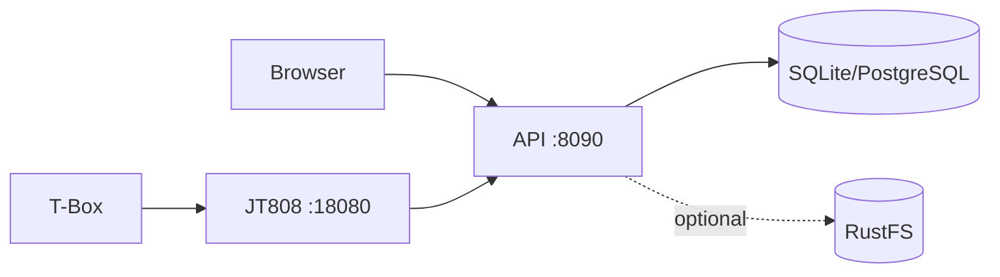
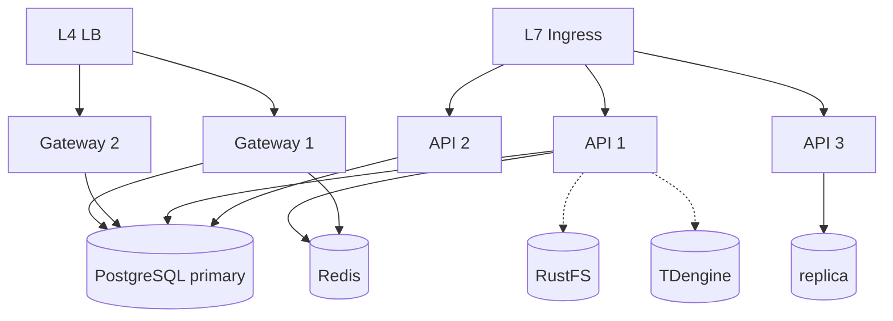
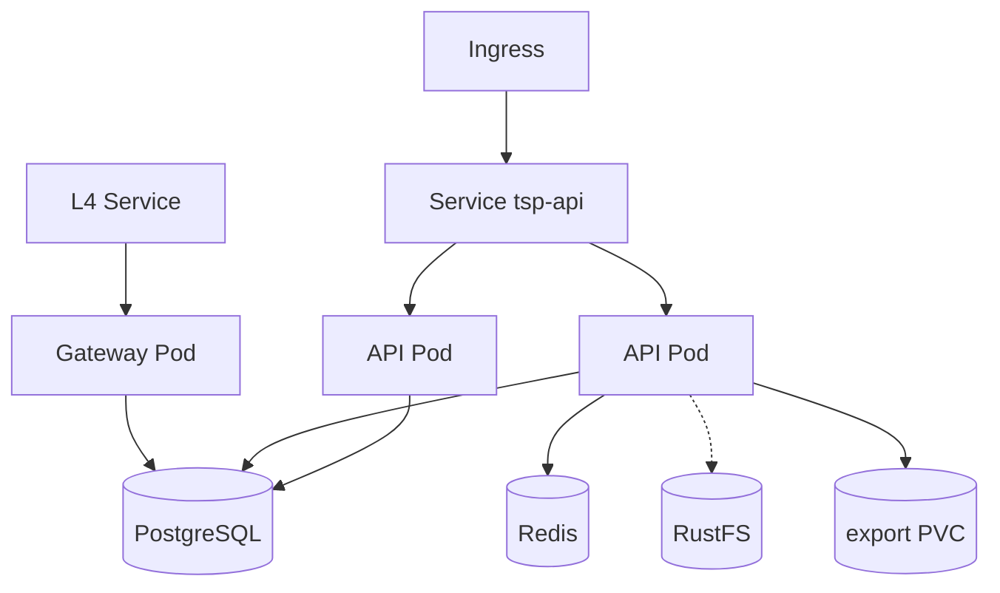
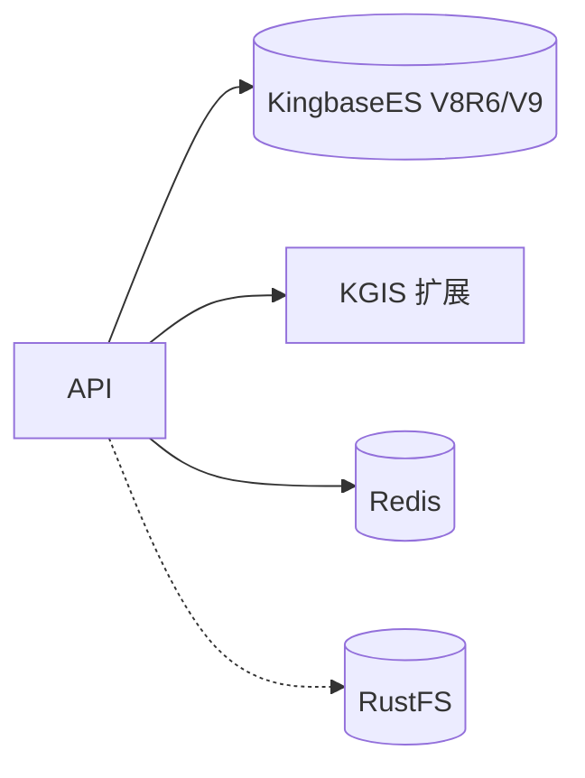

# 星途 TSP 部署架构

## 1. 部署形态

| 形态 | 数据库 | 适用 | 说明 |
| --- | --- | --- | --- |
| 本地演示 | SQLite | 开发/演示 | 单进程 |
| 单机生产 | PostgreSQL/KingbaseES | 中小车队 | 2 副本可选 |
| 集群 | PostgreSQL + Redis | 多 API/网关 | L4/L7 |
| 大型轨迹 | 上述 + TDengine | 高频轨迹 | 可选 |
| 信创 | KingbaseES + KGIS | 信创环境 | 需插件/License |

## 2. 本地/单机



```bash
TSP_BIND=127.0.0.1:8090
TSP_DATABASE=data/tsp.db
TSP_DEMO_MODE=true
cargo run --release
```

## 3. 集群



端口：

```text
8090-8092  API
18080-18082 JT808
19000/udp  JT1078
5432/54321 PostgreSQL/Kingbase
6379/56379 Redis
9000/9001  RustFS
6041       TDengine REST
```

## 4. Kubernetes



清单：

```text
deploy/k8s/
  namespace.yaml
  configmap.yaml
  secret.example.yaml
  postgres.yaml
  redis.yaml
  rustfs.yaml
  api.yaml
  gateway.yaml
  ingress.yaml
  autoscaling.yaml
  networkpolicy.yaml
  kustomization.yaml
```

完整链路 smoke：

- [KUBERNETES_SMOKE.md](KUBERNETES_SMOKE.md)

## 5. 信创部署



要求：

```text
DB_MODE=pg
ENABLE_CI=no
kingbase://... URL
TSP_POSTGIS_ENABLED=true（有 KGIS 时）
```

无 KGIS 时应用降级 lat/lon；不能承诺空间索引性能。

## 6. 数据持久化

| 数据 | 存储 | 备份 |
| --- | --- | --- |
| 业务表 | PostgreSQL/Kingbase | 全量 + WAL/PITR |
| 会话/租约 | Redis | 可重建 |
| 轨迹热数据 | PostgreSQL/TDengine | 按策略 |
| 媒体 | RustFS | 对象版本/跨桶 |
| 导出 | PVC/RustFS | 24h 清理 |
| 密钥 | Secret/Vault/KMS | 离线备份 |

## 7. 网络与 TLS

```text
Browser -> Ingress: HTTPS
T-Box -> Gateway: TLS/mTLS（推荐）
Gateway -> API: 内网
API -> DB: TLS（生产）
API -> Redis: rediss
API -> RustFS: HTTPS/内网
```

## 8. 资源建议

| 组件 | 请求 | 限制 |
| --- | --- | --- |
| API | 250m / 256Mi | 1 CPU / 1Gi |
| Gateway | 250m / 256Mi | 1 CPU / 1Gi |
| PostgreSQL | 500m / 1Gi | 2 CPU / 4Gi |
| Redis | 100m / 128Mi | 500m / 768Mi |
| RustFS | 按盘 | 按盘 |

## 9. 扩容

```text
API：无状态水平扩容，受 DB 连接池约束
Gateway：按长连接/文件描述符扩容
DB：垂直 + 只读副本 + 分区
TDengine：按写入/查询扩容
RustFS：多盘/多 Pool
```

## 10. 部署检查

```text
[ ] TSP_ENV=production
[ ] 管理员密码/默认账号
[ ] JWT/JT808/Redis/RustFS 密钥
[ ] DB 迁移/备份
[ ] 健康检查/就绪探针
[ ] Prometheus/Grafana
[ ] 日志集中化
[ ] Ingress TLS
[ ] NetworkPolicy
[ ] HPA/PDB
[ ] 回滚镜像
```

## 11. 相关文档

- [OPERATIONS_ARCHITECTURE.md](OPERATIONS_ARCHITECTURE.md)
- [BUSINESS_ARCHITECTURE.md](BUSINESS_ARCHITECTURE.md)
- [ARCHITECTURE_DIAGRAMS.md](ARCHITECTURE_DIAGRAMS.md)
- [OPERATIONS_GUIDE.md](OPERATIONS_GUIDE.md)
