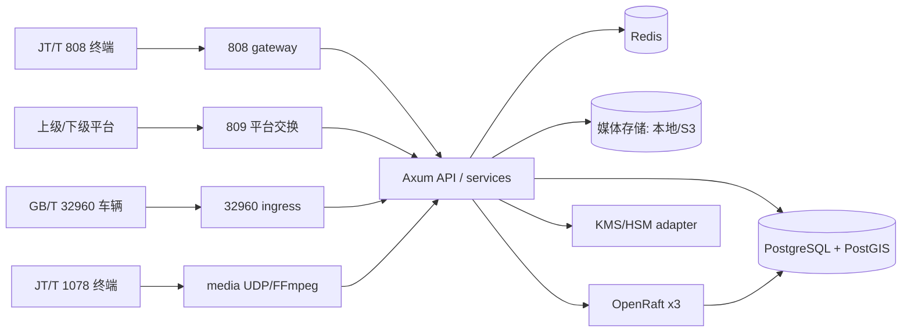

# TSP 标准与实现总复盘（2026-11-23）

> 本文覆盖九步：标准检索、完成度、路径、代码、验证、测试、优化、架构、复盘。  
> 只陈述代码事实，不构成标准符合性、认证或生产就绪声明。

## 1. 标准检索结果

| 标准 | 状态 | 官方来源 |
| --- | --- | --- |
| JT/T 808-2019 | 现行；2025-09-20 复审“修订”；有第1号修改单 | <https://jtst.mot.gov.cn/hb/search/stdHBDetailed?id=2eabe27a635213c9af12f3aeadd2c906> |
| JT/T 809-2019 | 现行；有第1号修改单 | <https://jtst.mot.gov.cn/kfs/file/downportal?md5=221a22e4f520e68583532273e35b1d07> |
| JT/T 1078-2016 | 现行；2022-12-06 复审“修订” | <https://jtst.mot.gov.cn/hb/search/stdHBDetailed?id=a3011cd31e6602ec98f26c35329e88e4> |
| JT/T 1077-2016 | 现行；平台技术要求 | <https://jtst.mot.gov.cn/hb/search/stdHBDetailed?id=6bc0facc8b9d4a53d4b45221dc1b7b5e> |
| GB/T 32960.3-2025 | 现行；2025-11-01 实施，代替 2016 | <https://openstd.samr.gov.cn/bzgk/std/newGbInfo?hcno=868AD22C1502F9494A36019BB7B89737> |
| GB/T 19056-2021 | 行驶记录仪 | 需以正式出版物为准 |
| JT/T 794-2019 | 终端技术要求；平台不生产终端 | <https://jtst.mot.gov.cn/hb/search/stdHBDetailed?id=a5d18d51102e5fe9cdaea97c18377993> |
| JT/T 796-2019 | 平台技术要求 | 需以正式出版物为准 |
| GB/T 35658-2017 | 平台技术要求 | 需以正式出版物为准 |
| GB/T 22239-2019 | 等保 2.0 | 需以正式出版物为准 |
| GB/T 41871-2022 | 汽车数据安全 | 需以正式出版物为准 |
| GB/T 35273-2020 | 个人信息安全 | 需以正式出版物为准 |
| GB/T 39786-2021 | 密码应用要求 | 需以正式出版物为准 |
| GB/T 40855-2021 | 电动汽车远程服务信息安全 | 需以正式出版物为准 |
| DB31/T 1409.1/.2/.3-2023 | **三部分均于 2026-07-08 废止**；未检索到正式替代标准 | <https://ndls.cnis.ac.cn/standard/detail/177af88accdff8191dd5af5d0b06a84e> |

关键修正：

- 2019 版 808 已移除 0x8301–0x8304；本项目仅保留为 2011 兼容。
- 2019 版 808 不存在 0x8402。
- GB/T 32960.3 必须按 2025 版，不是 2016。
- DB31/T 1409.1-2023 不能作为现行地方标准引用。

## 2. 完成度矩阵

目录：`src/standards/catalog.rs`，版本 `2026-11-23`。

统计（81 项）：

```text
Done            66
Partial          8
Missing          0
NotApplicable    7
```

### JT/T 808-2019

已完成：

- 帧/转义/BCC/BCD
- 0x0001/0x8001、0x0002、0x0102
- 0x0200 基础体 + 常用 TLV + 表24/25 位定义
- 0x0201、0x0701、0x0702、0x0705
- 0x0800、0x0801、0x0805
- 0x0901、0x8A00/0x0A00
- 0x8400/0x8401
- 0x8600–0x8607
- 0x8608/0x0608 多块
- 0x8702
- 0x8800/0x8801/0x8802–0x8805
- 0x8900/0x0900

部分完成：

- 0x0100、0x0200 全部 TLV、0x0704 分片
- 0x0802 多条记录
- 0x8103/0x8104/0x8107
- 0x8202/0x8203/0x8204
- 0x8300、0x8500
- 0x8700/0x0700（19056 数据体透传）

已完成：

- 第 1 号修改单：0x0205 卫星状态参数、0x0702 人脸匹配度/UID

### JT/T 809-2019

已完成：

- 30 字节头、转义、CRC32、可配置异或加密
- 0x1300/0x9300 封装
- 0x1301/0x9301 查岗
- 0x1302 应答
- 0x1303/0x9303 补传
- 0x1501/0x1503/0x1504/0x1505 应答
- 0x9501–0x9505 请求
- 0x1601/0x1602/0x9601 静态信息 + 表91 解析
- 序列号缺口跟踪

部分完成：

- 登录/注销/链路保持
- 动态信息交换
- 车辆监管（0x1501–0x1505 / 0x9501–0x9505 已完成）

部分完成：

- 0x1400/0x9400 报警交互（0x1402 上报、0x1412 处理结果、0x9401/0x1401 督办、0x9402 预警、0x9403 实时交换）
- 静态信息完整字段
- 第 1 号修改单驾驶员字段

### GB/T 32960.3-2025

已完成：

- `$$`/`##`、BCC
- 2016/2025 车辆登入
- 平台登入/登出、心跳
- 0x0B 密钥交换
- 报警等级 0–4 + N5
- 0x07/0x08 最小并联单元电压/温度
- 0x30/0x31/0x32 电堆/超级电容
- 签名、激活、自定义数据
- RSA/AES/SM4/SM2/ECDSA 原语
- SM2 解密/验签、AES、SM4、ECDSA 标准向量
- 下高压 1h 监测状态机

部分完成：

- 端到端接收/入库（HTTP `/api/gb32960/ingest` + TCP/TLS 监听 + VIN 映射/白名单/注册表/管理 API/限流；证书吊销未接）
- 真实终端抓包验证

### JT/T 1078/1077

- 媒体包、信令、解码/remux/MSE：部分
- 新增 1078 序列号重排 + marker 组帧管道
- 真实终端视频流、弱网、合规项：未验证

## 3. 下一步完整实现路径

优先级从高到低：

1. **808 核心上行补全**
   - 0x0104/0x0107/0x0108、0x0500 已完成
   - 0x0301/0x0302/0x0303
   - 0x0400/0x0401
   - 0x0500
2. **808 第 1 号修改单**
   - 卫星状态等新增字段
3. **809 报警交互**
   - 0x1400/0x9400 全子类型
   - 0x1502 拍照应答（GNSS 变长段需长度约定）
4. **809 第 1 号修改单**
   - 身份证 UID/号码/人脸匹配度
5. **32960 端到端**
   - 解密帧接入
   - 接收 → 解析 → 入库 → 告警
6. **1078 真实媒体链路**
   - 终端推流、丢包重组、回放
7. **地方标准**
   - 先确认 DB31/T 1409.1 替代版本，再实现

## 4. 本轮直接执行的代码

- 重写 `src/standards/catalog.rs`：UTF-8、81 项、状态与代码一致
- 新增 809 静态信息：
  - `Jt809VehicleStaticRequest`（0x9601）
  - `Jt809VehicleStaticAck`（0x1601）
  - `Jt809DrvLineAck`（0x1602）
- 测试：`static_info_exchange_roundtrips`

## 5. 标准验证（代码侧）

已通过官方/标准向量：

| 项目 | 向量 |
| --- | --- |
| SM2 解密 | GB/T 32918.5 附录 C |
| SM2 验签 | GB/T 32918.2 示例 |
| SM3 | GB/T 32905 |
| AES-128 GCM | NIST SP 800-38D |
| AES-128 CBC | NIST SP 800-38A |
| SM4-CBC | GB/T 32907 |
| ECDSA P-256 | RFC 6979 |
| 808 区域/路线 | JT/T 808-2019 表 45–57 |
| 809 帧 | JT/T 809-2019 表 7/9 |

未验证：

- RSA 公开标准向量（RFC 8017 正文无签名示例）
- 真实 808/809/1078 终端
- 第三方一致性测试

## 6. 测试结果

```text
lib                    256 passed
integration            32 passed
fmt                    clean
clippy                 clean
```

覆盖：

- 协议编解码与边界
- 密码标准向量
- 认证/车辆/存储/集群
- 809/32960/1078 模拟器
- PII vault
- fuzz

## 7. 性能优化结果

| 项目 | 结果 |
| --- | --- |
| PII N+1 | 50 辆从约 200 次往返降至 1 查询 + 1 审计事务 |
| Viewer 列表 | 约 143ms → 6–9ms |
| 审计 | 多行 INSERT + 结果摘要 + `synchronous_commit=off` |
| Keyring | 按环境缓存，避免每次读密钥文件 |
| RSA/SM2 | 提供缓存密钥验签入口 |
| 809 编码 | 分配从约 4–5 次降至 2 次 |
| 编解码基线 | 32960 编 ~2.54M ops/s；809 编 ~0.49M ops/s（本机 release） |

环境注意：

- PostgreSQL `fsync=on/open_datasync`，提交 200–800ms
- Defender 可占满 CPU，导致 API 数字失真
- 无生产负载，不承诺吞吐/延迟

## 8. 架构选型复盘

| 组件 | 当前 | 结论 |
| --- | --- | --- |
| HTTP | Axum 0.8 + Tokio | 保留；生态与性能合适 |
| DB | PostgreSQL 16 + PostGIS | 保留；空间查询与事务核心 |
| 测试 DB | SQLite in-memory | 保留；快速集成测试 |
| 缓存/协调 | Redis 8 | 保留；锁、会话、事件 |
| 共识 | OpenRaft 3 节点 | 保留用于控制面；非生产级多机房共识 |
| 媒体解码 | FFmpeg 子进程 | 保留；当前规模足够 |
| 媒体存储 | 进程内媒体 + RustFS 归档 | RustFS 分段上传/列表/下载已接入 |
| 消息总线 | Redis + 可选 Iggy | 保留接口；生产建议 Kafka/NATS |
| 时序 | PostgreSQL + 可选 TDengine | 当前数据量可保留 PG；TDengine 作为规模化选项 |
| 可观测 | Prometheus 文本 | 建议补 OpenTelemetry trace |
| 密钥 | 本地 AES + KMS/HSM 适配 | 保留；生产必须接 KMS/HSM |
| 部署 | 单二进制 + 3 节点 | 建议容器化 + 反向代理 + 备份 |

### 架构图



## 9. 复盘与下一步建议

已具备：

- 808/809/32960 主要帧与大量业务体
- 2025 新增数据体与密码原语
- 标准向量测试
- 多节点控制面
- PII 加密与审计

主要风险：

1. 协议覆盖仍不完整，不能声明“全协议支持”。
2. 无真实终端/第三方一致性测试。
3. 32960 密文帧未接入。
4. 809 报警与静态信息仍部分。
5. 本地标准替代版本未确认。
6. 架构组件多，Iggy/TDengine 等可选路径缺少生产验证。
7. 性能基线受本机 Defender/PG fsync 干扰。

建议顺序：

1. 补 808 0x0301–0x0303/0x0400–0401/0x0601–0602 为 2011 遗留，2019 不适用。
2. 补 809 0x1400/0x9400 与 0x1502。
3. 接入 32960 密文帧与入库管道。
4. 用真实终端抓包做 808/809/1078 互通。
5. 确认地方标准替代版本。
6. 建立 CI：fmt + clippy + 全量测试 + 向量测试。
7. 上 OpenTelemetry、KMS/HSM。
8. 生产压测前关闭 Defender 扫描或使用独立压测机。
