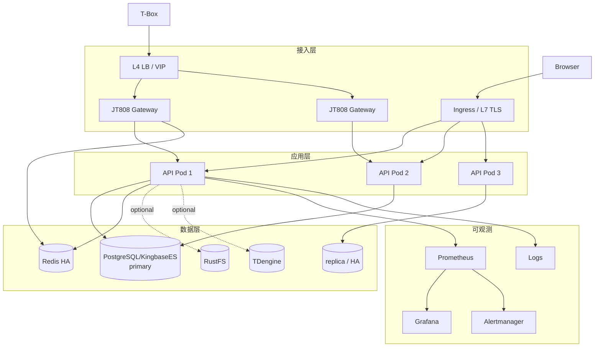
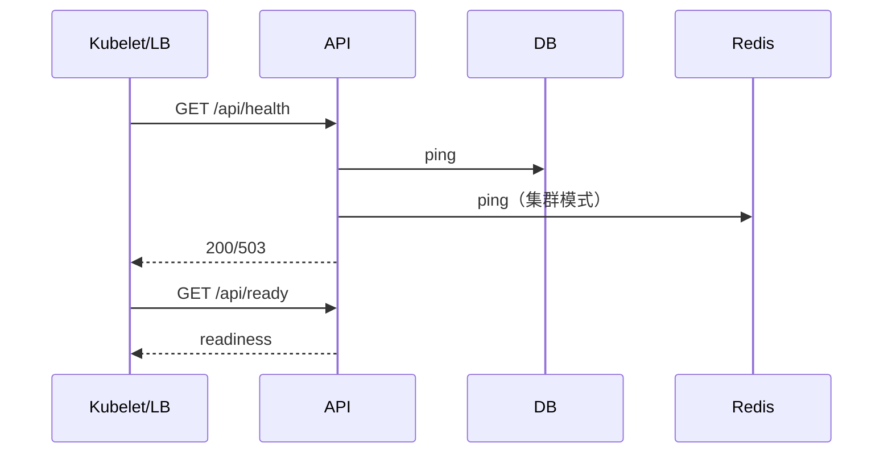
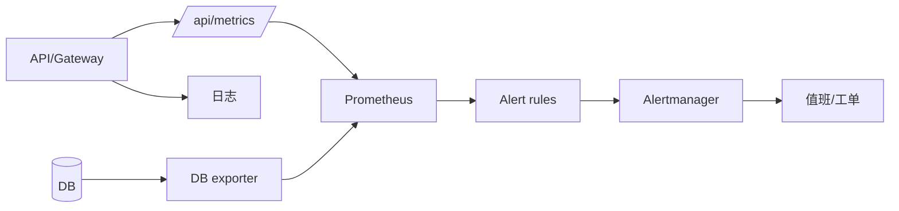
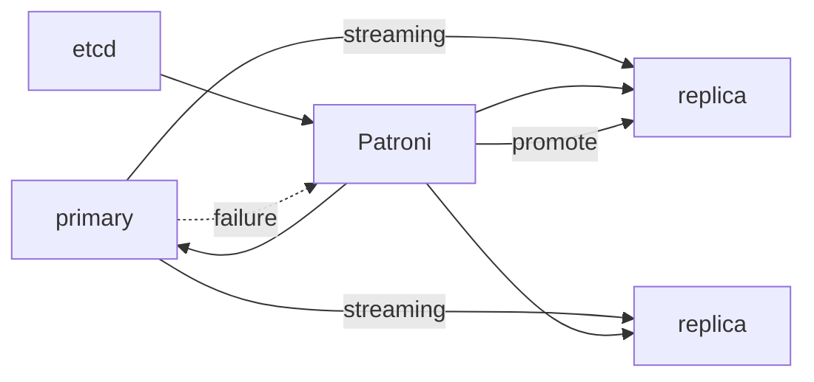

# 星途 TSP 运维架构

## 1. 运维目标

```text
可用性：API/网关可观测、可摘流、可回滚
一致性：数据库备份/PITR 可恢复
可观测：指标、日志、健康检查、告警
可运维：滚动升级、故障切换、容量扩展
安全：密钥、证书、审计、最小权限
```

## 2. 生产运行拓扑



## 3. 部署单元

| 单元 | 副本 | 说明 |
| --- | --- | --- |
| API | 2–N | 无状态，水平扩展 |
| JT808 Gateway | 2–N | 长连接，L4 负载 |
| Scheduler | 由 leader 选举 | 单活任务 |
| PostgreSQL | primary + replica | Patroni/云 RDS |
| Redis | Sentinel/Cluster | 会话/租约 |
| RustFS | 多盘/多 Pool | 媒体归档 |
| TDengine | 集群（可选） | 轨迹 |

## 4. 健康与流量



- `/api/health`：进程/数据库/可选依赖状态
- `/api/ready`：是否接流量；TDengine 模式要求探测成功
- `/api/metrics`：Prometheus
- 失败时先摘流，再重启/回滚

## 5. 监控与告警



关键指标：

```text
HTTP 5xx / latency
DB pool usage / errors
Redis connected
TDengine queue/spool/failures
RustFS upload failures
reconciliation mismatch
export job failures
JT808 online terminals
```

## 6. 高可用与故障切换

### 6.1 API/网关

```text
LB 健康检查 -> 摘除异常实例
API 无状态，滚动重启
网关长连接重连
```

### 6.2 PostgreSQL



- 手工 smoke：`scripts/postgres-ha-smoke.ps1`
- Patroni 自动 failover 已在开发机验证
- 生产需要 3/5 etcd、VIP/DNS、RPO/RTO 演练

### 6.3 Redis

- Sentinel/Cluster
- 应用支持连接失败时降级/报错，不保存业务真相

### 6.4 RustFS/TDengine

- RustFS 多盘/多 Pool + spool
- TDengine 集群 + 对账/spool
- 不作为业务真相源

## 7. 备份与恢复

```text
PostgreSQL: 每日全量 + WAL/PITR
KingbaseES: sys_dump/厂商工具 + 归档
Redis: 非权威，可重建
RustFS: 对象版本/跨桶备份
TDengine: 可重建，按需备份
配置/密钥: Secret Manager + 离线备份
```

恢复流程：

```text
1. 停止写入/摘流
2. 恢复数据库
3. 校验 schema_migrations
4. 启动 API/网关
5. 验证登录/车辆/轨迹
6. 恢复对账/导出
```

## 8. 发布与回滚


发布前：

```text
cargo fmt/clippy/test
数据库备份
迁移在预发执行
Secret/证书有效期检查
容量与磁盘检查
```

## 9. 安全运维

- 最小权限 RBAC
- JWT 私钥/证书轮换
- Redis/TLS、JT808 TLS/mTLS
- PII 删除接口审计
- 导出 AES-GCM + 单次令牌
- 日志脱敏，禁止记录明文 token/密码/完整 PII
- KMS/Vault 管理密钥

## 10. 事故响应

| 级别 | 场景 | 首要动作 |
| --- | --- | --- |
| P1 | API 全不可用/DB 不可写 | 摘流、切主/回滚 |
| P2 | TDengine 持续失败/复制延迟 | 停双写、spool、扩容 |
| P3 | 单实例重启/导出失败 | 重启、重试、观察 |

## 11. SLO 建议

```text
API 可用性 99.9%
5xx < 1% / 5min
登录 p95 < 1s
车辆列表 p95 < 300ms（10K）
dashboard 缓存命中 > 90%
复制延迟 < 5s
```

## 12. 相关文档

- [DEPLOYMENT_ARCHITECTURE.md](DEPLOYMENT_ARCHITECTURE.md)
- [BUSINESS_ARCHITECTURE.md](BUSINESS_ARCHITECTURE.md)
- [OPERATIONS_GUIDE.md](OPERATIONS_GUIDE.md)
- [POSTGRES_HA.md](POSTGRES_HA.md)
- [KUBERNETES_SMOKE.md](KUBERNETES_SMOKE.md)
