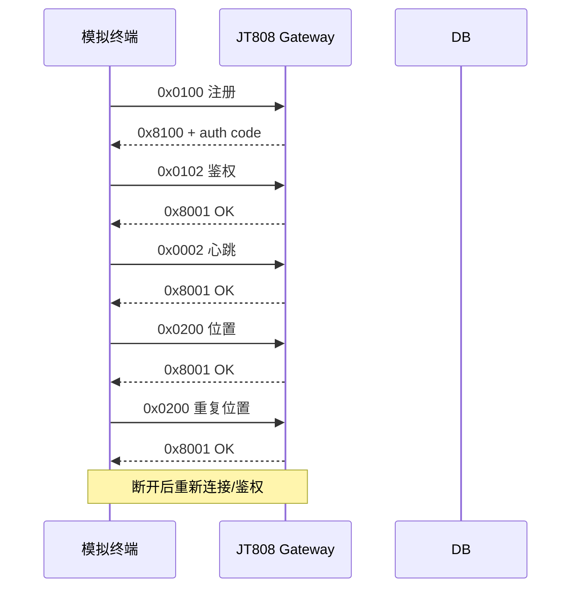

# 模拟测试矩阵

## 1. 目标

在缺少真实终端/监管平台/视频设备时，用协议级模拟覆盖可验证的边界：

```text
帧编解码
注册/鉴权/心跳
位置上报
重复/乱序/截断
断线重连
平台登录/报警/ACK
媒体包重排/回放
电气/电池/报警数据
```

模拟测试不能替代：

```text
真实 GPS/射频/车辆总线
真实视频编码器/摄像头
真实运营商弱网
真实监管平台/地方接口
官方一致性检测
```

## 2. 当前模拟

| 测试 | 类型 | 覆盖 | 不覆盖 |
| --- | --- | --- | --- |
| `jt808_terminal_sim.rs` | 真实 TCP + 模拟终端 | 注册/鉴权/心跳/位置、重复、重连、TCP 分片 | GPS/射频/车辆总线 |
| `jt809_sim.rs` | 真实 TCP mock 平台 | 登录、报警、ACK、重连 | 真实监管平台/TLS 认证 |
| `jt809_tls_sim.rs` | TLS mock | 证书链路/登录 | 生产 CA/双向认证 |
| `gb32960_sim.rs` | 命令/数据单元 | 登录/实时/补发/登出/报警/电池 | 官方测试集 |
| `jt1078_sim.rs` | 合成媒体 | 信令、RTP 包、H.264 重组 | 真实摄像头/弱网 |
| `standards_conformance.rs` | 固定夹具/负向 | 808/809/1078/32960 帧 | 第三方一致性 |
| `standards_fuzz.rs` | 随机输入 | 不 panic/不越界 | 语义正确性 |
| `postgis_health.rs` | 真实 PostGIS（opt-in） | health/ready 的 postgis 分支 | KGIS 插件/License |

## 3. JT/T 808 模拟终端

测试：

```text
tests/jt808_terminal_sim.rs
```

流程：



断言：

```text
注册返回 auth code
鉴权成功
心跳成功
位置入库
重复时间戳不产生第二条 telemetry
重连后心跳成功
单帧拆成两段发送仍可重组
```

## 4. 运行

```bash
cargo test --test jt808_terminal_sim -- --nocapture
cargo test --test jt809_sim -- --nocapture
cargo test --test gb32960_sim -- --nocapture
cargo test --test jt1078_sim -- --nocapture
cargo test --test standards_conformance -- --nocapture
```

## 5. 结论

模拟测试可以把“协议路径未验证”降为“协议路径本地已验证”，但生产 Go/No-Go 中的真实终端/平台/视频项仍不能关闭。生产证据必须来自真实设备、真实网络和第三方检测。
